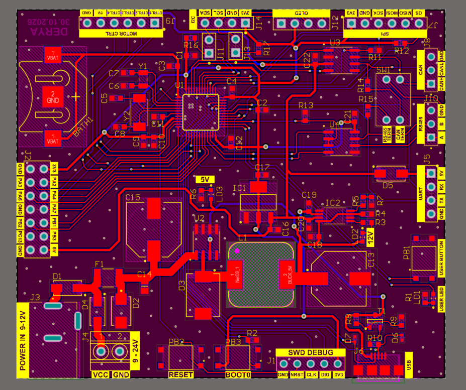
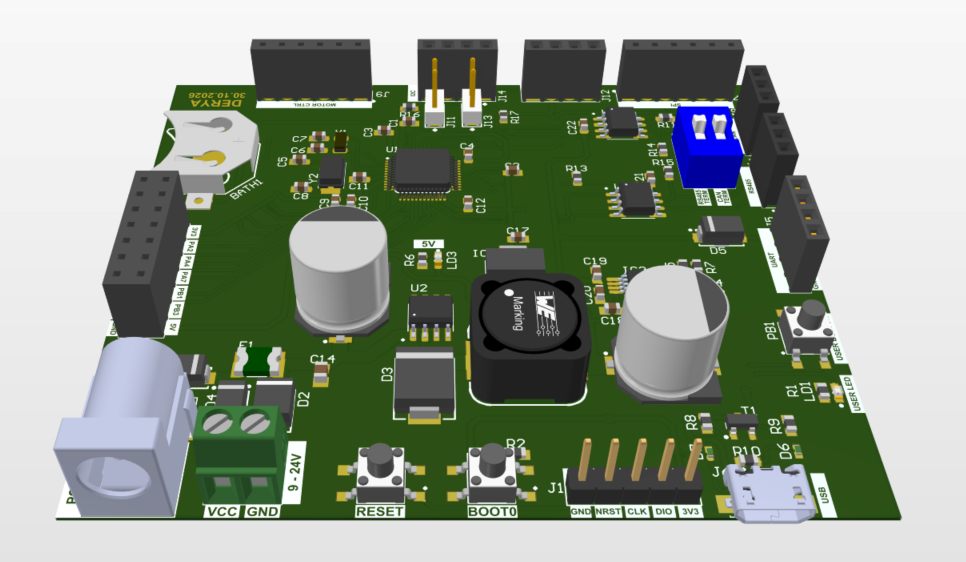

# STM32F303 Development Board

A custom **2-layer STM32 development board** designed from schematic to PCB layout in **Altium Designer**. The project was created to support hands-on learning and experimentation with embedded systems, MCU peripherals, communication protocols, and hardware design.

Built around the **STM32F303CBT6 (ARM Cortex-M4)**, the board combines multiple communication interfaces, flexible power inputs, and accessible debugging and expansion connections.

The design was developed with component availability, PCB manufacturing, cost, and **manual assembly at home** in mind.

> **Project status:** Schematic and PCB layout completed. PCB fabrication, assembly, and hardware validation are the next stages.

## Board Preview

| 2D PCB Layout | 3D PCB Render |
|:---:|:---:|
|  |  |

### [Interactive 3D PCB Model](https://personal-viewer.365.altium.com/client/index.html?feature=embed&source=AEE5FF48-ADE6-47BB-BB53-68D347CB4686&activeView=3D)

The STM32 DevBoard can be viewed in interactive 3D through the link above.

No installation or Altium account required.

## Hardware Overview

| Category | Implementation |
|---|---|
| Microcontroller | STM32F303CBT6, ARM Cortex-M4, LQFP-48 |
| PCB | Custom 2-layer PCB |
| Grounding | GND polygon pours on both top and bottom  layers |
| External power | DC input with input protection and step-down regulation |
| Power management | XL1509 buck converter, TPS2115A power multiplexer, SPX1117-family LDO |
| Power capacity | Designed for up to 1 A on the 5 V rail |
| Communication | USB 2.0 Full-Speed, CAN, half-duplex RS485, UART, SPI, I²C |
| Programming / debugging | SWD, USB DFU, BOOT0 and RESET controls |
| Clocking | 8 MHz high-speed crystal; 32.768 kHz RTC crystal |
| Expansion | GPIO breakout, I²C/OLED connections, four motor-control signal outputs |
| User interface | User button, status LED, reset and boot buttons |

## Hardware Architecture

### Power Input, Protection & Regulation

The power subsystem supports operation from either an external DC supply or USB power.

- **Input protection:** Protection diodes, a resettable fuse, and transient-voltage suppression are included in the external DC power path.
- **5 V conversion:** An XL1509 switching buck regulator converts the protected DC input into a regulated 5 V supply.
- **Power source selection:** A TPS2115A power multiplexer manages the selection between the buck-derived 5 V rail and USB 5 V.
- **3.3 V regulation:** An SPX1117-family LDO provides the supply for the MCU and 3.3 V peripherals.
- **Power indicators:** LEDs provide visual indication of the power system.

### Microcontroller, Clocks & Debugging

- **STM32F303CBT6** microcontroller in an LQFP-48 package, selected for its digital peripherals and integrated analog capabilities.
- External **8 MHz HSE crystal** for system clock generation.
- **32.768 kHz LSE crystal** and VBAT battery backup for RTC operation.
- Decoupling capacitors placed close to the MCU power pins.
- Dedicated **SWD interface** for programming and debugging using an external ST-Link.
- **USB DFU support** for firmware programming through the MCU's system bootloader.
- Physical RESET, BOOT0, and user buttons.

### Communication Interfaces

| Interface | Hardware implementation / purpose |
|---|---|
| **USB** | Micro-USB Type-B connector, USB Full-Speed interface, ESD protection, and DFU programming |
| **CAN** | External CAN transceiver, CANH/CANL connector, and switchable 120 Ω termination |
| **RS485** | Half-duplex transceiver, direction control, A/B connector, and switchable termination |
| **UART** | Header for connection to an external 3.3 V USB-to-UART adapter |
| **SPI** | Breakout header for external SPI peripherals with a dedicated chip-select signal |
| **I²C** | External headers, pull-up resistors, and OLED display connection |

### GPIO & Motor-Control Expansion

Selected MCU signals are exposed through expansion headers to support different embedded development applications.

Four control signals are routed to a dedicated motor-control header for use with **external motor drivers**.

No high-current motor driver is integrated into the PCB.

## Engineering Design Decisions

### Why a Power MUX Instead of Diode OR-ing?

The initial power management design used diode OR-ing to combine USB and external 5 V power sources.

This approach was replaced with the **TPS2115A Power Multiplexer** to reduce the forward-voltage drop and associated power losses introduced by diodes.

The TPS2115A uses low-resistance internal MOSFET switches to select between the two 5 V sources, while providing controlled source switching, reverse-current blocking, and adjustable current limiting.

This decision was made to improve **power efficiency and overall power management reliability**.

### Why Micro-USB Type-B?

Micro-USB Type-B was selected for the STM32's **USB Full-Speed interface** and its straightforward connector wiring.

Compared to USB Type-C, it provides a simpler implementation for the requirements of this development board.

The selected connector footprint was also better suited to **manual soldering with the tools available at home**, which was an important consideration for this prototype.

### Why Aluminum Electrolytic Capacitors?

Aluminum electrolytic capacitors were selected for the buck converter's input and output filtering instead of tantalum capacitors, primarily to reduce BOM cost at the required capacitance values.

### Component Selection & Cost Awareness

Component selection was based on electrical requirements, component availability, footprint compatibility, cost, and assembly constraints.

1. **Availability:** Components were researched according to stock availability at Özdisan.
2. **Footprint compatibility:** Component packages and mechanical dimensions were verified against datasheets.
3. **Cost optimization:** Alternative components and package options were evaluated to reduce unnecessary BOM costs.
4. **Manual assembly:** Package dimensions, pin pitch, and soldering accessibility were considered because the first prototype will be assembled by hand.

These considerations directly influenced the final component and package selections.

### PCB Layout & Manufacturability

- Schematic capture organized into three sections: **Core**, **Communication**, and **Power**.
- Component placement and routing completed on a **2-layer PCB**.
- Attention given to power distribution, signal routing, decoupling placement, and mechanical accessibility.
- Switchable CAN/RS485 termination and clearly labeled external connections.
- PCB layout developed with manual component assembly and soldering accessibility in mind.
- Solder-mask and silkscreen rules reviewed for fine-pitch components and connectors.
- **Design Rule Check (DRC): 0 active violations**, with 6 documented Board Clearance waivers.

## Schematics & Design Files

The Altium project is divided into three main schematic documents.

| Document | Contents | PDF |
|---|---|---|
| **Core** | STM32 MCU, oscillator circuits, RTC, boot/reset, SWD, and GPIO expansion | [View Core Schematic](Doc/Schematics/Core.pdf) |
| **Communication** | USB, CAN, RS485, UART, SPI, I²C, OLED, and motor-control headers | [View Communication Schematic](Doc/Schematics/Com.pdf) |
| **Power** | DC inputs, protection, 5 V buck conversion, power source selection, and 3.3 V regulation | [View Power Schematic](Doc/Schematics/Power.pdf) |

Native Altium project files (`.SchDoc`, `.PcbDoc`, `.SchLib`, and `.PcbLib`) are included in the repository for design review and further development.

## Next Steps

1. Generate fabrication outputs and order the PCB.
2. Assemble the prototype manually.
3. Perform initial power-up and verify the regulated supply rails.
4. Validate MCU programming, debugging, clocking, and communication interfaces.
5. Document prototype assembly and hardware testing results.

## Tools

- **Altium Designer** — schematic capture, custom component libraries, PCB layout, DRC, and 3D visualization.
- **Altium 365** — interactive 3D PCB visualization and design sharing.
- **Datasheets and component catalogs** — electrical and mechanical verification, component selection, and sourcing. Reference documents are available in the [`Doc/`](Doc/) directory.
- **Git & GitHub** — version control and technical project documentation.

---

**Designed by Emirhan Derya** · Electronics Engineering Graduate, Gebze Technical University